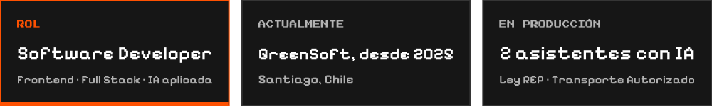
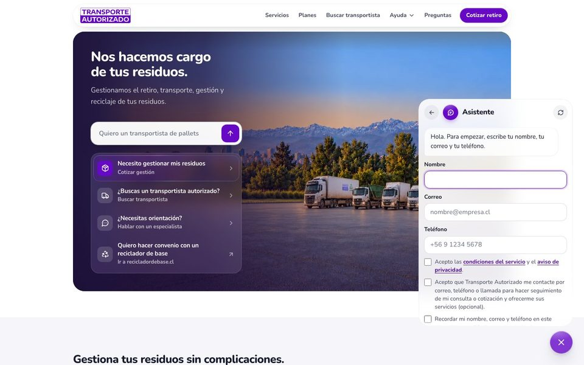
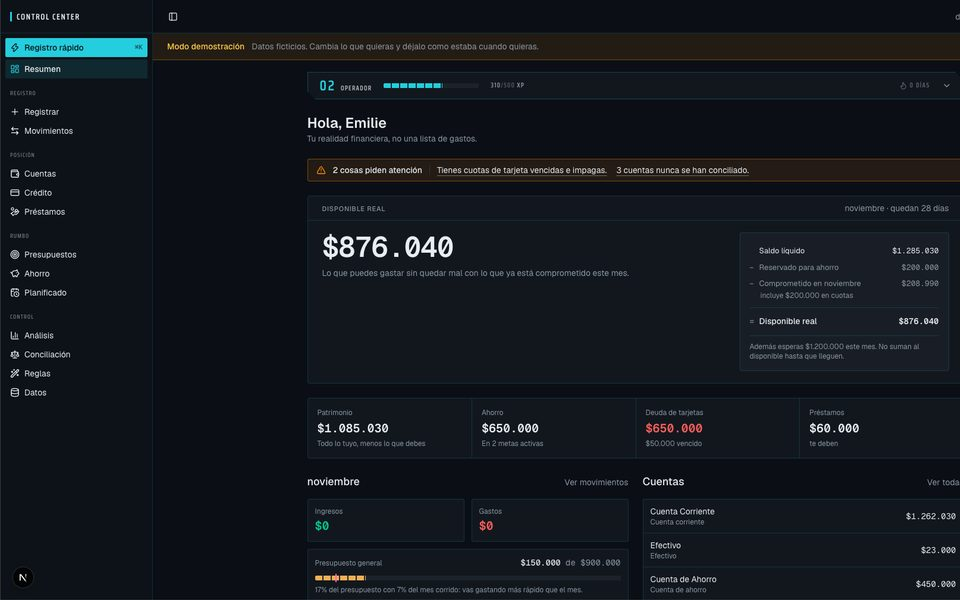
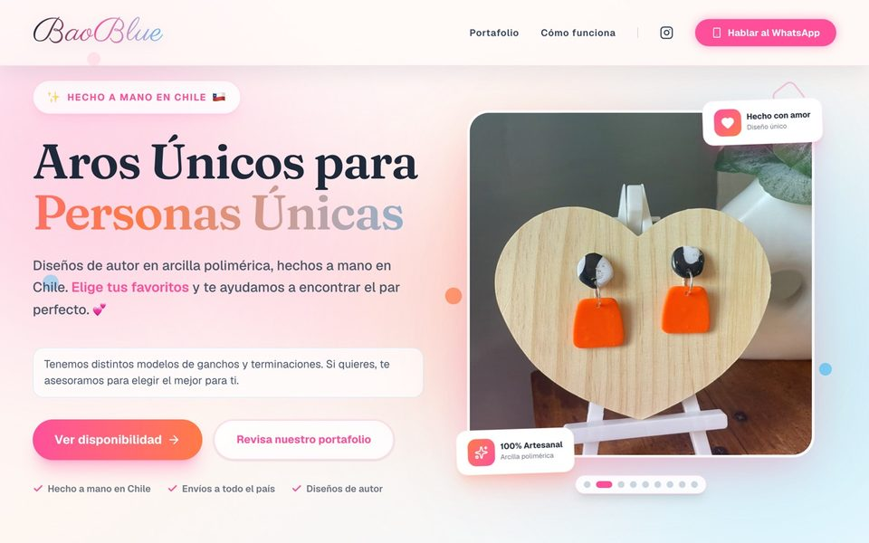

  

  
  
  
  
  

  Desarrollo aplicaciones web y asistentes con IA, <b>desde la interfaz hasta el backend y sus integraciones</b>.

  

## En producción

<table>
  <tr>
    <td width="50%" valign="top">
       
      <a href="https://jlandaeta.dev/es/proyectos/orbix"><b>Asistente Ley REP</b></a> · IA en WhatsApp
    </td>
    <td width="50%" valign="top">
       
      <a href="https://jlandaeta.dev/es/proyectos/transporte-autorizado"><b>Asistente Transporte Autorizado</b></a> · IA en webchat
    </td>
  </tr>
  <tr>
    <td width="50%" valign="top">
       
      <a href="https://jlandaeta.dev/es/proyectos/restal"><b>Restal</b></a> · finanzas personales, producto propio
    </td>
    <td width="50%" valign="top">
       
      <a href="https://jlandaeta.dev/es/proyectos/baoblue"><b>BaoBlue</b></a> · landing freelance
    </td>
  </tr>
</table>

<b>Stack:</b> React · Next.js · TypeScript · Laravel · MySQL · PostgreSQL · DeepSeek · Vercel AI Gateway · WhatsApp Cloud API

<a href="https://jlandaeta.dev/es#proyectos">Más proyectos y casos de estudio en jlandaeta.dev →</a>

## Actividad

  

La mayor parte de mi trabajo está en repositorios privados de GreenSoft.

