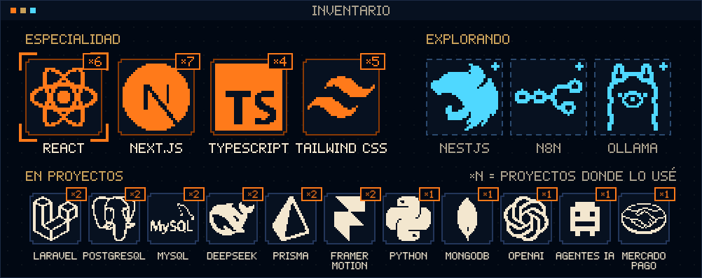

  

  
  
  
  

  Construyo productos digitales de principio a fin: interfaces, reglas de negocio, integraciones e IA cuando resuelve un problema real.

## 🕹️ Ficha de personaje

  

## 📜 Bitácora de misiones

  

Antes de GreenSoft: [BaoBlue](https://jlandaeta.dev/es/proyectos/baoblue) como freelance (2025), [LEXY](https://jlandaeta.dev/es/proyectos/lexy) como proyecto de título (2024–2025) y práctica profesional en PwC Chile, área de Assurance (2024).

## 🧩 Proyectos

<table>
  <tr>
    <td colspan="2">
       
      <a href="https://jlandaeta.dev/es/proyectos/fcc"><b>Financial Control Center</b></a> · en desarrollo 
      Dominio financiero, arquitectura y producto 
      <code>Next.js</code> <code>TypeScript</code> <code>Prisma</code> <code>PostgreSQL</code> <code>Better Auth</code> <code>Vitest</code>
    </td>
  </tr>
  <tr>
    <td width="50%" valign="top">
       
      <a href="https://jlandaeta.dev/es/proyectos/orbix"><b>Asistente de Ley REP</b></a> · en producción · <a href="https://leyrep.cl">leyrep.cl</a> 
      Atención por WhatsApp con IA 
      <code>Laravel</code> <code>DeepSeek</code> <code>WhatsApp Cloud API</code>
    </td>
    <td width="50%" valign="top">
       
      <a href="https://jlandaeta.dev/es/proyectos/baoblue"><b>BaoBlue</b></a> · en producción · <a href="https://baoblue-web.vercel.app">Demo</a> · <a href="https://github.com/JeremyLandaeta/baoblue-web">Código</a> 
      Landing de marca y catálogo artesanal 
      <code>Next.js</code> <code>Tailwind CSS</code> <code>Framer Motion</code>
    </td>
  </tr>
</table>

Más casos de estudio en el portafolio:

- [Dixta](https://jlandaeta.dev/es/proyectos/dixta) · pipeline editorial con IA y revisión humana
- [0 Carbono · EcoREP](https://jlandaeta.dev/es/proyectos/greensoft) · interfaces para operaciones ambientales
- [LEXY](https://jlandaeta.dev/es/proyectos/lexy) · chatbot legal + backoffice
- [tu-dominio.cl](https://jlandaeta.dev/es/proyectos/pagos) · venta de dominios con Mercado Pago
- [Anrra](https://jlandaeta.dev/es/proyectos/anrra) · mockup de landing para productos en madera
- [jlandaeta.dev](https://jlandaeta.dev/es/proyectos/portfolio) · el portafolio, con identidad RPG

## 🎒 Inventario

  

Stack completo en texto

- **Especialidad:** `React` `Next.js` `TypeScript` `Tailwind CSS`
- **En proyectos:** `Laravel` `Python` `PostgreSQL` `MySQL` `MongoDB` `Prisma` `Framer Motion` `DeepSeek` `OpenAI` `Agentes IA` `Mercado Pago`
- **Herramientas:** `Material UI` `Ant Design` `PHP` `REST APIs` `SQL Server` `Docker` `GitHub` `ApiDOG` `Power BI` `Bitrix24` `Claude`
- **Explorando:** `NestJS` `n8n` `Ollama`

  

